# CMO Scenario Studio

A desktop scenario creation suite for **Command: Modern Operations** (CMO), written in Python with PyQt6.

Design a scenario on a real map with live values from your own DB3000 / CWDB database, then export it as the
same structured folder the official Lua-driven scenarios use: a one-shot `Build_Scenario.lua` that builds every
side, unit, mission and event through CMO's Lua API, the runtime scripts the events call, and the
`[LOADDOC]` description and briefing pages.

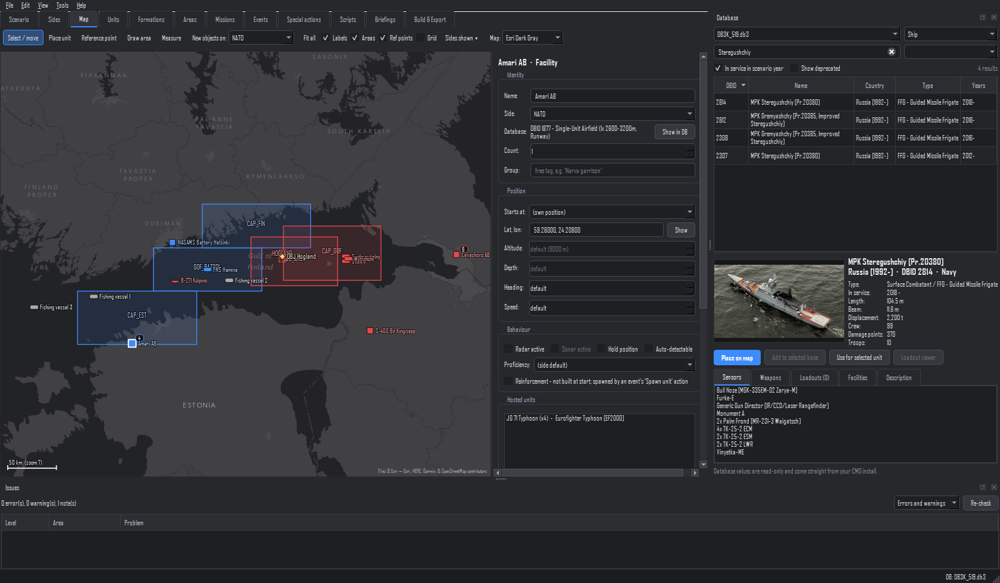

## Features

- **Database browser** — search DB3000/CWDB (read-only) by name, DBID, country and in-service year; see images,
  sensors, weapons, aircraft loadouts (with their weapons), hangar/dock facilities and the DB description text.
- **Map editor** — slippy map (Esri, OpenStreetMap, OpenTopoMap or offline grid) to place units, build airbases
  with squadrons, draw patrol/trigger areas, drop reference points and measure ranges and bearings.
- **Formations** — 40 ready-made layouts (naval screens and columns, carrier group, convoy, ASW bent-line, air
  finger-four, ladder, wall, ground wedge, coil, SAM dispersal and more, plus custom stations) with spacing,
  orientation, altitude step, mirror and jitter controls and a live preview. Create new units straight into a
  formation from the database, or group existing ones; they are built as CMO groups with formation stations.
- **Event timeline** — every event and mission on the scenario clock: one-shot moments, random windows, repeating
  ticks and condition triggers, with problems flagged (outside the scenario, same-minute clashes, missions ending
  before they start). Double-click to edit.
- **Search everything** (Ctrl+K) — jump to any unit, mission, event, area, formation, script line or command.
- **Edit many units at once** — tick the fields to change across a selection: rename patterns (`Escort {nn}`),
  side, group, proficiency, EMCON, hold, heading, speed, altitude, base, loadout and more, in one undo step.
- **Patrol area library** — 208 predefined sea and air patrol areas by region (Europe, United Kingdom,
  Arctic, Middle East, Africa, Asia, Oceania, North and South America): Bay of Biscay, GIUK gaps, Baltic, Hormuz, Taiwan Strait, South
  China Sea, Falklands TEZ, CAP boxes, AEW orbits, tanker tracks and more. Add one (or several) with a patrol or
  support mission ready to staff. The UK set covers the whole of UK airspace with official UK AIP boundaries
  for the London and Scottish FIRs (QRA South/North), the ranges' danger areas and air-to-air refuelling areas
  AARA 1-14, plus eight interception sectors tiling the FIR, approach zones, CAP stations and AEW orbits.
  Editable JSON library; save your own areas into it.
- **UK military sites** — 101 real UK sites at their actual positions (1575 units): 46 air bases laid
  out from OpenStreetMap with every mapped runway at its real heading and length (82 runways), 108 hardened
  aircraft shelters, 286 hangars, aprons, control towers, radars, fuel and munitions storage; plus naval bases,
  radar heads, command centres, comms and intelligence sites, depots and garrisons. Place a whole base at its real
  location in one go.
- **Unit templates** — 80 pre-grouped sites (670 units in all) dropped in one go: airfields of every size,
  hardened and dispersed air bases, FARPs, command posts and C3 bunkers, communications, SIGINT and EW sites, radar
  and SAM sites, barracks, FOBs, depots, ports and naval bases, missile sites and civil infrastructure. Name it,
  orient it, place it; it stays together as a CMO group. Editable JSON library, and any selection can be saved as a
  new template.
- **Callsigns** — name aircraft from an editable JSON library of 38 air arms (NATO and beyond), ~365 squadrons
  and 1,100+ callsign words, by detected country and role (fighter, strike, SEAD, AEW, tanker, MPA, helicopters...),
  in flights: `TARTAN 11–14`, `SOKOL-21`... Rename, add or share entries in the built-in library editor.
- **Loadout Viewer** (Ctrl+L) — every loadout of an aircraft with role, radius, time on station, ready and
  quick-turnaround times, mission profile and Winchester/Shotgun rule; the weapons it carries with quantities and
  ranges; each weapon's ranges, PoK, warheads, seekers, targets and capabilities; and links to every other aircraft
  and loadout that carries the same loadout or weapon. Apply a loadout to the selected squadron in one click.
- **Order of battle** — sortable unit table, hosted aircraft and boats, counts (`Sqn #1..#n`), loadouts,
  radar/sonar EMCON, hold position, proficiency, reinforcements spawned later by events, extra `ScenEdit_SetUnit` fields.
- **Sides** — awareness, proficiency, computer-only, starting score, doctrine and a full posture matrix.
- **Missions** — patrol, strike, support, ferry, mining, mine clearing and cargo, with areas, prosecution areas,
  assigned units, strike targets and `ScenEdit_SetMission` options.
- **Events** — triggers (time, date, delay, unit destroyed/damaged/detected, area entry, points...), conditions,
  probability and actions (message, score, end scenario, mission on/off, flags, spawn reinforcements, Lua), with
  templates and a live preview of the generated Lua.
- **Scripts & special actions** — Lua editor with highlighting, snippets and syntax check in CMO's own Lua 5.4.
- **Briefings** — HTML editor with live preview, auto header and an order-of-battle generator.
- **Build variants** — "Play as X" versions where other sides are computer-controlled, each with its own launcher
  and description page (as in *If Russia Wins*).
- **Validation and dry-run** — over 40 checks (including every DBID and loadout against the database), plus a
  dry-run that executes the generated builder and every event script in CMO's `lua54.dll` against a strict mock
  of the ScenEdit API — before you ever open CMO.
- **Export** — install straight into the CMO folder (only studio-written files are replaced, with a backup zip),
  to any folder (e.g. a git repository) or as a zip.
- **Import** — read the order of battle from an existing *If Russia Wins*-style `Build_Scenario.lua`.
- Undo/redo for every edit, autosave, recent files, a headless command line for CI.

## Screenshots

| Events with generated Lua | Missions |
| --- | --- |
| 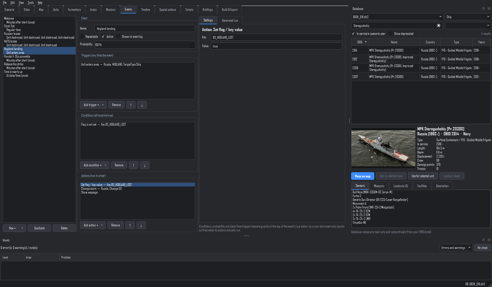 | 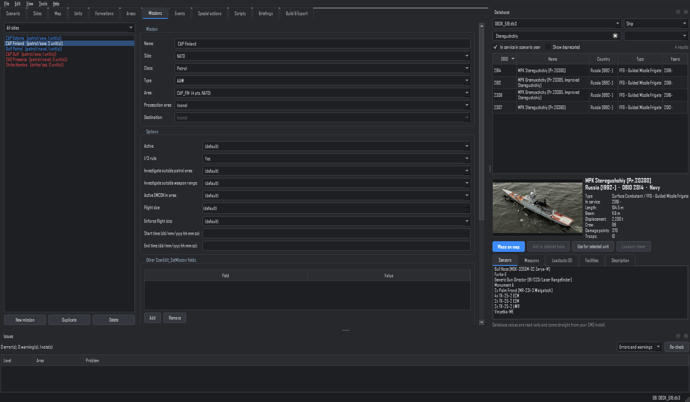 |
| **Briefings with live preview** | **Build & Export with dry-run** |
|  |  |

| Formations | Create units in formation |
| --- | --- |
| 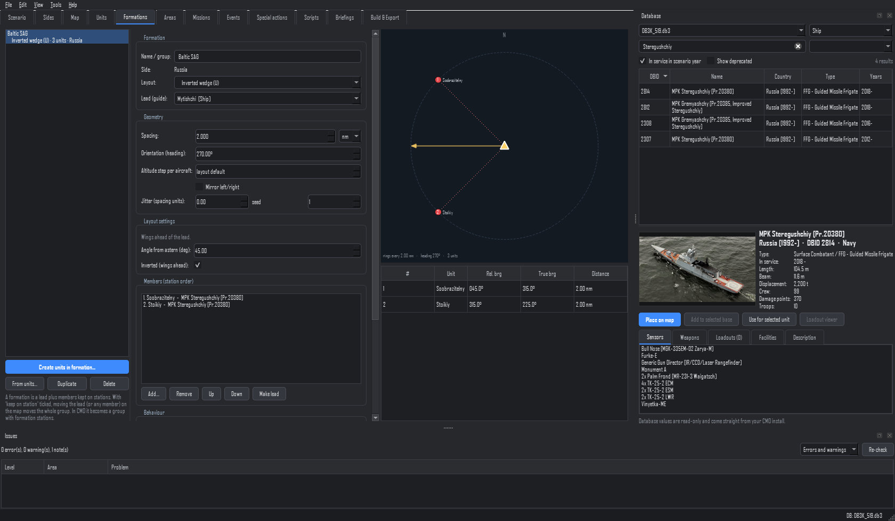 | 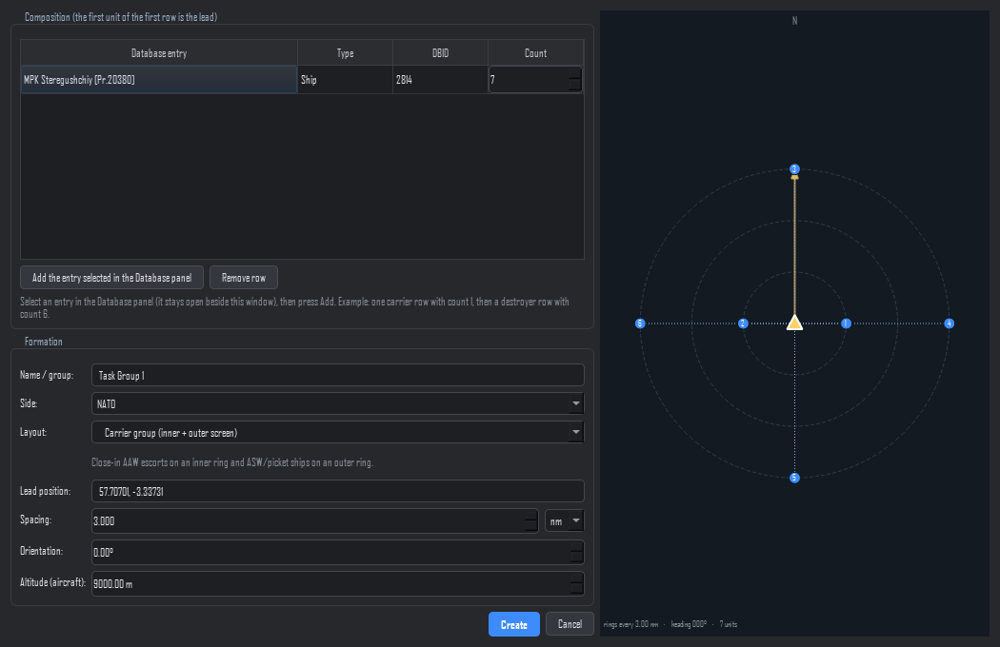 |

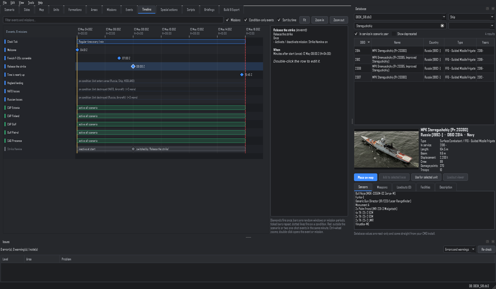

| Search everything (Ctrl+K) | Edit many units at once |
| --- | --- |
| 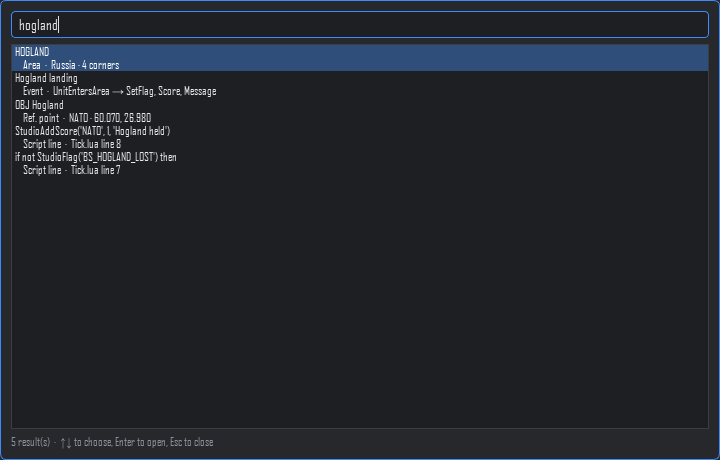 | 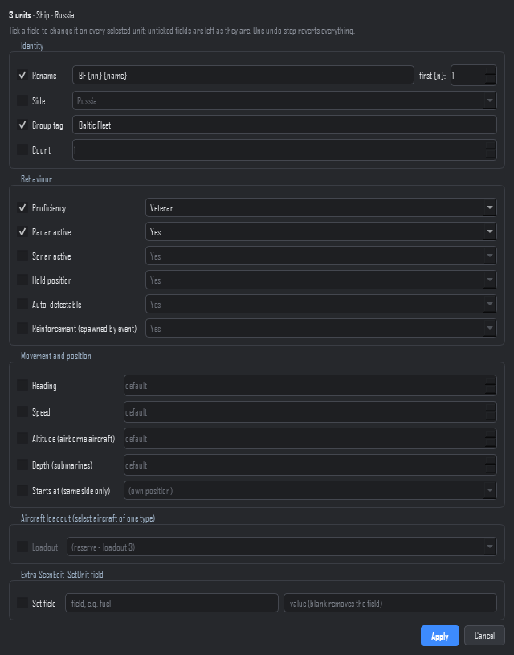 |

| Patrol area library | Areas added on the map |
| --- | --- |
| 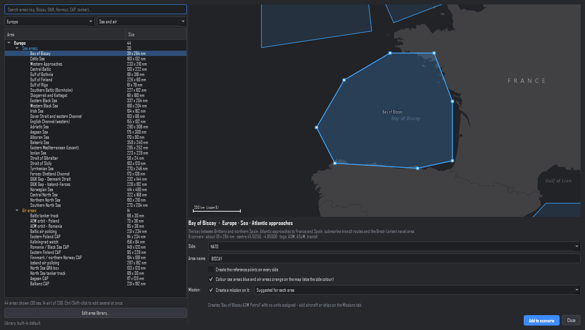 | 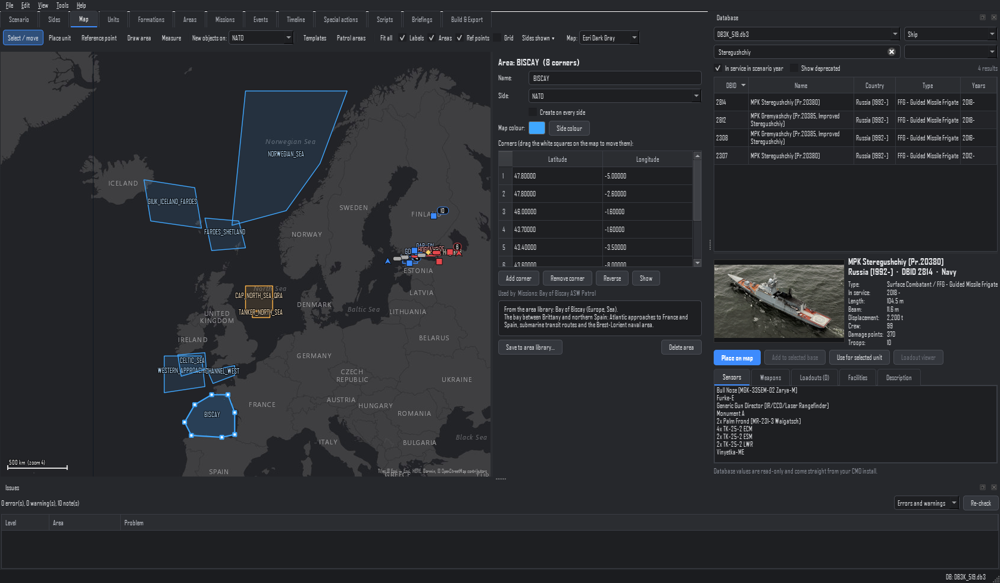 |

| UK air base at its real site | UK interception sectors |
| --- | --- |
| 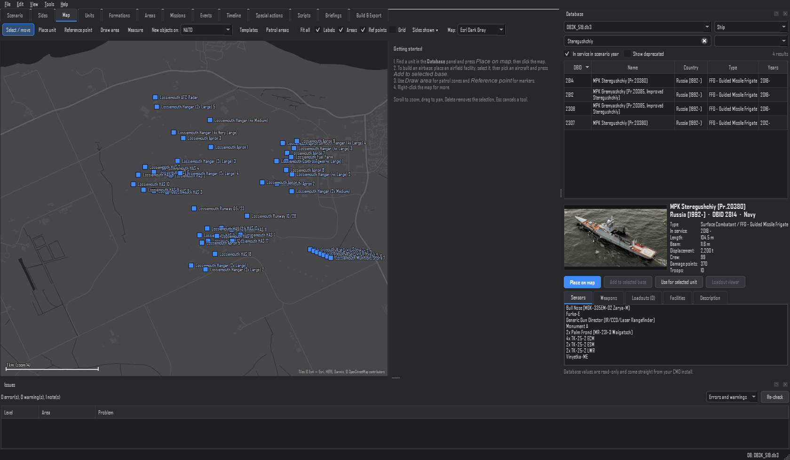 | 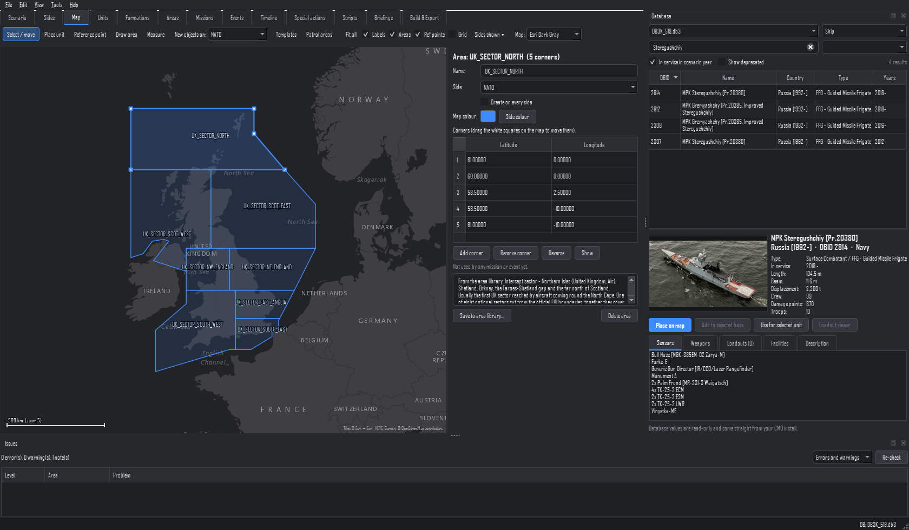 |

| Place a unit template | Placed on the map |
| --- | --- |
| 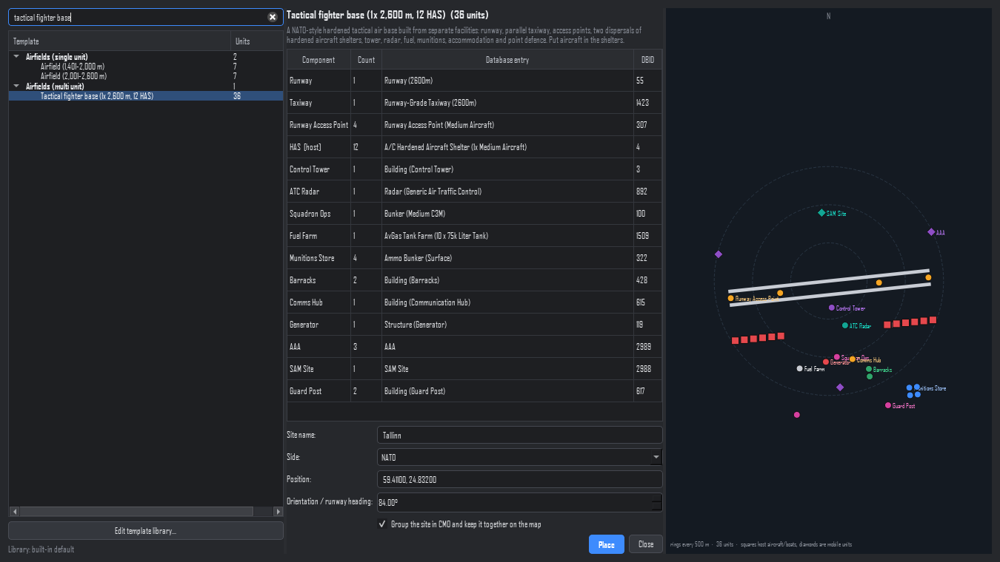 | 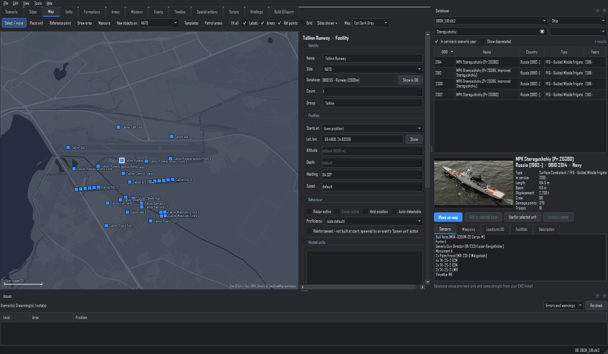 |

| Assign callsigns | Callsign library |
| --- | --- |
| 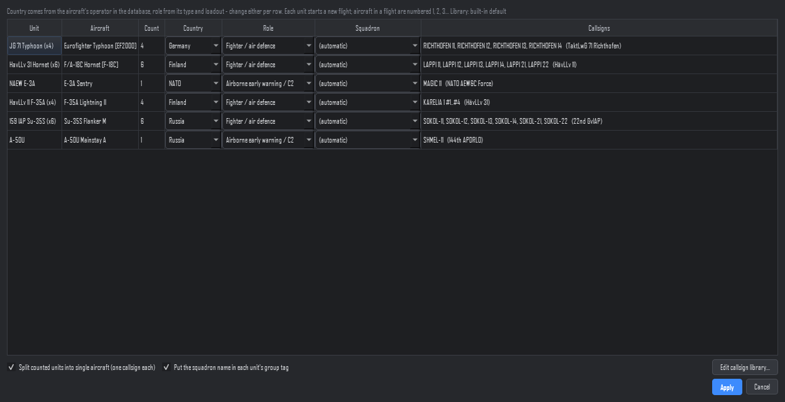 | 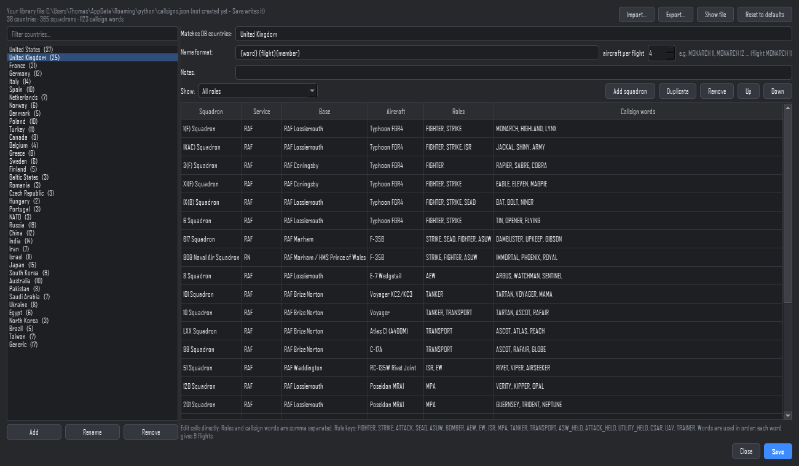 |

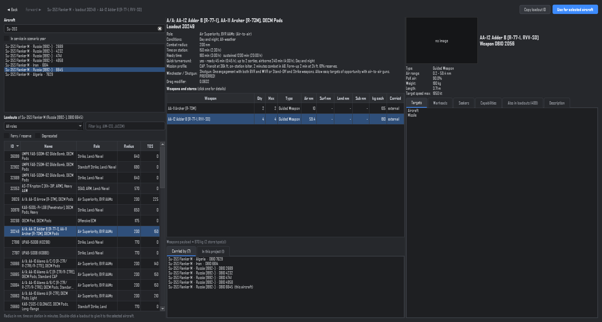

## Download

Get **`CMO-Scenario-Studio-<version>-win64.zip`** from the
[Releases page](https://github.com/MasonicTombomb/CMO-Scenario-Studio/releases), unzip it anywhere and run
`CMO-Scenario-Studio.exe`; no Python needed. Windows may show a SmartScreen warning because the exe is not
code-signed (*More info > Run anyway*).

To run from source instead, see [Quick start](#quick-start).

## Requirements

- Windows with Command: Modern Operations installed (the studio reads `DB\*.db3` and uses `lua54.dll`)
- Python 3.10+ (64-bit)
- PyQt6

The project format, exporter and tests also run without CMO; the database browser, DB checks and dry-run need it.

## Quick start

```bash
git clone <this repository>
cd CMO-Scenario-Studio
python -m venv .venv
.venv\Scripts\activate
pip install -r requirements.txt
python run_studio.py
```

or install it as a command: `pip install -e .` then `cmo-studio`.

On first start the studio looks for CMO in your Steam libraries; if it is elsewhere, choose it in
**File > Settings**. Then open `examples/Baltic Sentinel.cmoproj` to see a complete scenario.

## From project to playable .scen

1. **Build & Export** tab → *Validate*, *Dry-run build*, then *Export* → *Install into the CMO folder*.
2. In CMO: **Create New Blank Scenario** with the same database.
3. Editor → **Lua Script Console**:
   ```lua
   ScenEdit_RunScript('/Your Scenario/Build_Scenario.lua')
   ```
4. Paste the `[LOADDOC]` lines from the build report into the scenario description and side briefings,
   and save as `Scenarios\Your Scenario\Your Scenario.scen`.

Variants: start from a new blank scenario and run `Build_<KEY>.lua` instead.

## Exported layout

```
Lua/<Scenario>/                     Scenarios/<Scenario>/
  Build_Scenario.lua                  <Prefix>_Desc.html
  Build_<VARIANT>.lua                 <Prefix>_Desc_<VARIANT>.html
  LuaInit.lua                         <Prefix>_Briefing_<SIDE>.html
  Studio_Runtime.lua                  briefing_style_dark.css
  <YourScripts>.lua                   (your .scen files go here)
  project.cmoproj
  README.txt
```

See [`examples/output`](examples/output) for a real export.

## Documentation

- [User guide](docs/USER_GUIDE.md) — every tab, workflows and tips
- [Export format and Lua runtime](docs/EXPORT_FORMAT.md) — what each file does, the `Studio*` Lua API
- [Project file format](docs/PROJECT_FORMAT.md) — the `.cmoproj` JSON schema
- [Patrol area library](docs/AREAS.md) — format and full list of areas
- [Unit templates](docs/TEMPLATES.md) — format, catalogue and the UK real-world sites
- [Callsign library](docs/CALLSIGNS.md) — the JSON format, roles and allocation rules
- [Database access](docs/DATABASE.md) — which DB3000 tables are read and how
- [Architecture](docs/ARCHITECTURE.md) — code layout for contributors
- [Changelog](CHANGELOG.md) · [Contributing](CONTRIBUTING.md)

## Command line

```bash
cmo-studio "examples/Baltic Sentinel.cmoproj"                  # open a project
cmo-studio project.cmoproj --dry-run --cmo "D:/Steam/.../Command - Modern Operations"
cmo-studio project.cmoproj --export ./build                   # export without the GUI
```

## Building the exe

```bash
pip install -e .[dev] pyinstaller
python packaging/build_release.py
```

This writes `release/CMO-Scenario-Studio-<version>-win64.zip` and its `.sha256`, after a smoke test of the frozen
exe. Pushing a tag such as `v1.0.0` makes GitHub Actions build the same zip and publish a release with the notes in
`docs/releases/<version>.md`. That is the only workflow: ordinary pushes run nothing, so run `pytest` locally first
(the release job runs it once more before building).

## Tests

```bash
pip install -r requirements-dev.txt
pytest
```

Tests that need CMO (database, Lua) find it automatically or via `CMO_DIR`; they are skipped otherwise.

## Disclaimer

Not affiliated with or endorsed by Matrix Games, Slitherine or WarfareSims. *Command: Modern Operations* and its
databases are their property; this tool reads them from your own installation and redistributes none of their
data. Map tiles are provided by their respective services under their terms.

## License

The UK air base layouts in `templates_uk.json` are derived from OpenStreetMap (© OpenStreetMap contributors, ODbL) - see [THIRD_PARTY_NOTICES.md](THIRD_PARTY_NOTICES.md).

MIT — see [LICENSE](LICENSE).
